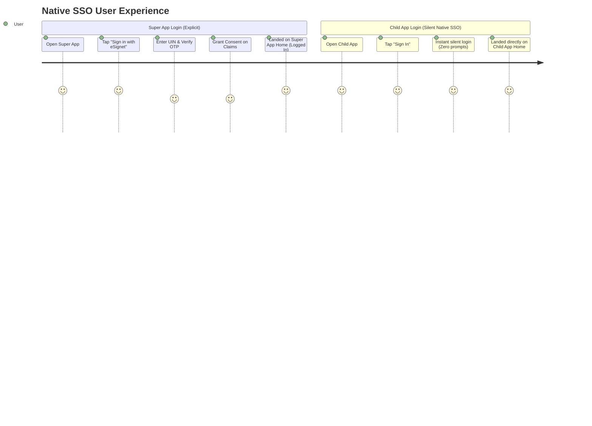

# MOSIP Decode 2026 — Problem Statement 03: Enable Native SSO in eSignet Go for Mobile Apps
> **Project Brain Dump & Master Technical Guide for Team Collaboration**  
> *Target Hackathon: MOSIP Decode 2026 (Synergy '26, IIIT Bangalore)*

---

## 📌 Executive Summary & Key Deadlines

| Key Parameter | Details |
| :--- | :--- |
| **Problem Statement** | `03 eSignet \| Enable Native SSO in eSignet Go for Mobile Apps` |
| **Complexity Level** | Medium |
| **Hackathon Window** | August 17, 2026 – November 6, 2026 |
| **Registration Deadline** | **September 13, 2026** *(MANDATORY: All team members must be registered)* |
| **Evaluation Period** | November 2026 |
| **Prize Pool** | ₹5,00,000 INR (~$5,000 USD) + MOSIP Internship Opportunities + MOSIP Connect 2027 Showcase |
| **Team Size** | 1 to 5 members (Undergraduate, Postgraduate, or PhD students with valid college ID) |
| **Submission Email** | `decode@mosip.io` + Submission via [Unstop Portal](https://unstop.com/hackathons/mosip-decode-2026-synergy-26-international-institute-of-information-technology-iiit-bangalore-1735221) |

---

## 🎯 The Core Problem: Why Are We Building This?

In mobile operating systems (Android and iOS), mobile applications run in isolated sandboxes and **do not share browser cookies, session caches, or local storage**. 

Today, if a trusted vendor creates multiple mobile apps in the MOSIP/eSignet ecosystem (e.g., a *National Digital Wallet*, a *Tax Portal App*, and a *Health Portal App*):
1. The user is forced to re-authenticate (OTP, biometrics, password) repeatedly in **every single app**, even though all apps belong to the same trusted vendor and the user has already proven their identity on the same physical device.
2. This creates extreme friction, poor user experience, and repetitive identity verification calls.

### The Solution: OpenID Connect Native SSO for Mobile Apps
By implementing the **OpenID Connect Native SSO for Mobile Apps 1.0** standard on top of eSignet’s new **Go backend** (which uses the **ThunderID Engine** with the FAPI 2.0 security profile):
* A **Super App** performs the initial interactive authentication (e.g., OTP login) and acquires a cryptographically bound `device_secret`.
* A **Child App** (signed with the same vendor certificate on the same device) exchanges that `device_secret` silently using OAuth 2.0 **Token Exchange** (`grant_type=token_exchange`).
* **Result:** Instant, zero-friction, silent single sign-on across the vendor’s mobile apps without compromising cryptographic security.

---

## 👥 The User Journey



1. **First Mobile App (Super App):**
   * User opens Super App -> taps **"Sign in with eSignet"**.
   * App opens system browser (Custom Tab) to eSignet login.
   * User enters MOSIP ID / UIN, receives OTP, enters OTP, reviews consent screen for requested claims and scopes, and taps **"Allow"**.
   * User is redirected back to Super App and is logged in.
   * Behind the scenes, Super App securely receives and persists:
     * `access_token`
     * `id_token` (containing `ds_hash`)
     * `device_secret` (signed JWT bound to hardware key)
2. **Second Mobile App (Child App):**
   * User opens Child App (from the same vendor) and taps **"Sign In"**.
   * Child App communicates with Super App via inter-app IPC (e.g., Android Bound Service / AIDL or shared Secure Enclave/Keychain).
   * Super App verifies Child App's signature matches the same vendor certificate, signs a DPoP proof, and hands over the credentials.
   * Child App executes a silent OAuth 2.0 **Token Exchange** with eSignet's token endpoint.
   * **Zero UI prompt:** User lands directly on Child App’s home screen without ever seeing a login or consent screen!

---

## 🏗️ Technical Architecture & Flow Specifications

The flow is secured by **FAPI 2.0** (Pushed Authorization Requests [PAR] + Demonstrating Proof-of-Possession [DPoP] + PKCE + Client Assertions).

### 1. Super App Flow (PAR + DPoP + Device Secret Issuance)
```
Super App                  eSignet / ThunderID Backend                 Identity Backend
   |                                    |                                     |
   |-- 1. Generate Key A (Keystore) ----|                                     |
   |-- 2. POST /oauth2/par ------------>|                                     |
   |      (scope: openid ... device_sso)|                                     |
   |      (DPoP proof thumbprint cnf.jkt)|                                    |
   |<- 201 {request_uri} ---------------|                                     |
   |                                    |                                     |
   |-- 3. Open Browser to /authorize -->|                                     |
   |                                    |-- 4. Authenticate User (OTP) ------>|
   |                                    |<-- Auth Success --------------------|
   |                                    |-- 5. User Consent Approved -------->|
   |<- 6. 302 Redirect with Code -------|                                     |
   |                                    |                                     |
   |-- 7. POST /oauth2/token ---------->|                                     |
   |      (grant_type=authorization_code|                                     |
   |       code, code_verifier, DPoP)   |-- 8. Validate DPoP & PKCE           |
   |                                    |-- 9. Check allowed_scopes for device_sso
   |                                    |-- 10. DeviceSecretProvider.GenerateDeviceSecret()
   |                                    |       - cnf.jkt = Key A thumbprint  |
   |                                    |       - compute ds_hash             |
   |                                    |       - embed ds_hash in id_token   |
   |<- 11. 200 OK ----------------------|                                     |
   |       access_token                 |                                     |
   |       id_token (with ds_hash)      |                                     |
   |       device_secret (signed JWT)   |                                     |
```

### 2. Child App Flow (Silent SSO via Token Exchange)
```
Child App                     Super App (SSO Service)            eSignet / ThunderID Backend
   |                                     |                                   |
   |-- 1. IPC Request (Session Transfer)->|                                  |
   |                                     |-- 2. Verify Child App cert signature
   |                                     |-- 3. Construct & Sign DPoP proof  |
   |                                     |      (htu=/oauth2/token, htm=POST)|
   |<- 4. Return id_token, device_secret,|                                   |
   |      and signed DPoP proof ---------|                                   |
   |                                                                         |
   |-- 5. POST /oauth2/token ----------------------------------------------->|
   |      grant_type = token_exchange                                        |
   |      subject_token = <id_token>                                         |
   |      subject_token_type = urn:ietf:params:oauth:token-type:id_token     |
   |      actor_token = <device_secret>                                      |
   |      actor_token_type = urn:openid:params:token-type:device-secret       |
   |      client_id = <ChildApp_client_id>                                   |
   |      scope = <subset of original scopes, NO device_sso>                 |
   |      Header DPoP: <signed DPoP proof from Key A>                        |
   |                                                                         |
   |                                     |-- 6. Validate id_token signature  |
   |                                     |-- 7. Validate actor_token         |
   |                                     |      DeviceSecretProvider.ValidateDeviceSecret()
   |                                     |-- 8. Verify ds_hash in id_token matches hash(device_secret)
   |                                     |-- 9. Verify cnf.jkt matches DPoP key thumbprint
   |                                     |-- 10. Check scope is subset & reject device_sso
   |                                     |-- 11. Replay protection: mark device_secret jti used
   |                                     |-- 12. Bind new tokens to SAME cnf.jkt
   |<- 13. 200 OK (access_token, id_token for Child App) -------------------|
   |                                                                         |
   |-- 14. GET /oauth2/userinfo (with DPoP proof from Super App) ----------->|
   |<- 15. 200 OK User Claims (PII) -----------------------------------------|
```

---

## 💻 Code Repositories & Where to Contribute

The MOSIP eSignet Go ecosystem is partitioned into two major repositories plus the mobile client apps:

```
MOSIP Native SSO Ecosystem
├── 1. mosip/esignet (branch: develop-go)
│      └── esignet-service/  (Go 1.26 Backend Service)
├── 2. thunder-id/thunderid (main/backend)
│      └── backend/          (OIDC / OAuth Core Engine Library)
└── 3. Mobile Client Applications (Your team's repo)
       ├── SuperApp/         (Android Kotlin / iOS Swift)
       └── ChildApp/         (Android Kotlin / iOS Swift)
```

### Repository 1: `mosip/esignet` (Branch: `develop-go`)
* **Repo Link:** [https://github.com/mosip/esignet/tree/develop-go](https://github.com/mosip/esignet/tree/develop-go)
* **Components to modify:**
  1. `internal/clientmgmt`: Support and configure `device_sso` scope in `allowed_authorization_scopes` for registered clients.
  2. `internal/engine`: Implement the `DeviceSecretProvider` interface:
     * `GenerateDeviceSecret(ctx, ...)`: Produces signed JWT containing:
       - `cnf.jkt` (DPoP key thumbprint)
       - `auth_id`
       - `client_id`
       - `scope`
       - `acr`
       - `claims`
       - `iss`
       - `exp` (Expiry time)
       - `jti` (Unique JWT ID)
     * Computes `ds_hash = BASE64URL(SHA-256(device_secret))` and embeds it into the `id_token`.
     * `ValidateDeviceSecret(ctx, client_id, device_secret)`: Validates the token, signature, expiry, and ensures Child App is allowed.
  3. `cmd/esignet/main.go`: Wire the provider via `thunderidengine.WithDeviceSecretProvider(...)`.

### Repository 2: `thunder-id/thunderid` (Directory: `backend/`)
* **Repo Link:** [https://github.com/thunder-id/thunderid](https://github.com/thunder-id/thunderid)
* **Components to modify:**
  1. `pkg/thunderidengine/providers`: Define and export the `DeviceSecretProvider` interface.
  2. `internal/oauth/oauth2/constants`: Add constants:
     - `TokenTypeIdentifierDeviceSecret = "urn:openid:params:token-type:device-secret"`
     - `ScopeDeviceSSO = "device_sso"`
  3. `internal/oauth/oauth2/granthandlers/token_exchange.go`:
     - Update `ValidateGrant`: Accept `actor_token_type = urn:openid:params:token-type:device-secret`.
     - Update `HandleGrant`:
       - Invoke `DeviceSecretProvider.ValidateDeviceSecret(...)`.
       - Validate binding between `id_token` and `device_secret` via `ds_hash`.
       - Verify `cnf.jkt` in `device_secret` matches DPoP header thumbprint.
       - Enforce scope rules: requested scope must be a subset of original scope.
       - Reject token exchange if `device_sso` is requested.
       - Replay protection (prevent reusing the same `jti` if single-use policy enabled).

### Repository 3: Mobile Apps (Team Repository)
* Recommended stack: **Android (Kotlin)** or **iOS (Swift)**.
* **Super App:**
  * Generates asymmetric key in Android Keystore / iOS Secure Enclave (Key A never leaves device).
  * Initiates standard OIDC login with `scope=openid profile ... device_sso` and DPoP header.
  * Receives `id_token`, `access_token`, `device_secret`.
  * Exposes an Android Bound Service (protected by `android:protectionLevel="signature"`) or Shared Keychain Access Group.
  * Signs DPoP proofs for Child App requests.
* **Child App:**
  * Connects to Super App service, requests session and signed DPoP proof.
  * Executes Token Exchange against `/oauth2/token`.
  * Fetches user profile data from `/oauth2/userinfo`.

---

## 📋 Detailed Task Checklist

### Phase 1: Prerequisite & Setup
- [ ] Register team on the [Unstop Hackathon Page](https://unstop.com/hackathons/mosip-decode-2026-synergy-26-international-institute-of-information-technology-iiit-bangalore-1735221) (**Before Sep 13, 2026**).
- [ ] Create test accounts on [MOSIP Self-Registration Portal](https://self-register.collab.mosip.net/).
- [ ] Explore the [MOSIP Collab Sandbox](https://collab.mosip.net/).
- [ ] Fork and clone `mosip/esignet` (`develop-go` branch) and `thunder-id/thunderid`.
- [ ] Run `esignet-service` locally with Postgres and Redis (or in-memory store).

### Phase 2: Backend Implementation (Mandatory Tasks 1–6, 9–10)
- [ ] **Task 1:** Add support for `device_sso` scope in authorization requests.
- [ ] **Task 2:** Enforce client validation for `device_sso` scope at token endpoint (`allowed_authorization_scopes`).
- [ ] **Task 3:** Define `DeviceSecretProvider` interface in ThunderID engine.
- [ ] **Task 4:** Implement `GenerateDeviceSecret` and `ValidateDeviceSecret` in `esignet-service`.
- [ ] **Task 5:** Calculate `ds_hash = BASE64URL(SHA-256(device_secret))` and inject it into `id_token`.
- [ ] **Task 6:** Return `device_secret` along with `access_token` and `id_token` in `/oauth2/token` response.
- [ ] **Task 9:** Implement Token Exchange handler in ThunderID for `actor_token_type=urn:openid:params:token-type:device-secret`:
  - [ ] Validate `actor_token` via `ValidateDeviceSecret`.
  - [ ] Verify `ds_hash` inside `id_token`.
  - [ ] Validate `sid` (session ID).
  - [ ] Verify `cnf.jkt` matches DPoP key thumbprint.
- [ ] **Task 10:** Enforce scope downscoping rules:
  - [ ] Child app scope must be $\subseteq$ Super App original scope.
  - [ ] Reject any token exchange request containing `device_sso`.

### Phase 3: Mobile Apps Implementation (Mandatory Tasks 7–8)
- [ ] Create Super App & Child App in Android Studio (or Xcode) signed with the **same certificate**.
- [ ] Implement Keystore Keypair generation (`Key A`) in Super App.
- [ ] Integrate "Sign in with eSignet" via Chrome Custom Tabs in Super App.
- [ ] Build Inter-App IPC service (Android Bound Service with signature verification):
  - [ ] Super App verifies caller's package signature matches its own.
  - [ ] Super App signs DPoP proof for Child App using Key A.
  - [ ] Passes `id_token`, `device_secret`, and DPoP proof to Child App.
- [ ] Child App triggers silent Token Exchange on launch and lands on Home Screen.
- [ ] Child App calls `/oauth2/userinfo` with DPoP proof and displays user claims.

### Phase 4: Bonus Task
- [ ] **Bonus 1:** If the Child App requests scopes that differ from or exceed what was originally consented to in the Super App, trigger an interactive re-consent screen.

---

## 📦 Required Hackathon Deliverables

According to the official `Submission_Guidelines_MOSIP_Decode_2026.pdf`, the following deliverables are mandatory:

1. **Working Prototype:** Fully functional demonstration of Super App, Child App, and eSignet Go backend.
2. **Git Repository:** Hosted on GitHub/GitLab with complete, incremental commit history showing team collaboration.
3. **Postman Collection:** Complete collection containing:
   - PAR request with DPoP
   - Authorize redirect URL
   - Token request (Authorization Code)
   - Token Exchange request (Native SSO)
   - Userinfo request with DPoP
4. **Documentation:**
   * **README.md:** Step-by-step installation, environment config, and run instructions.
   * **Technical Design Document:** Architectural flow, RFC mappings, sequence diagrams, and security rationale.
   * **API Documentation:** Request/response schemas and error status codes.
5. **Pitch Presentation (Deck):** 5–7 slides (or 1–2 page document) covering:
   - Problem statement & real-world relevance.
   - Architectural solution & standards compliance (OIDC Native SSO + FAPI 2.0).
   - Tech stack & implementation details.
   - Potential impact on MOSIP ecosystem.
6. **Video Demo:** Short video (2 to 5 minutes) showing:
   - Live demo of Super App explicit login.
   - Live demo of Child App silent SSO.
   - Explanation of code and security architecture.
7. **Test Cases & Test Data:** Test matrix verifying:
   - Happy path (SSO success)
   - Key mismatch / DPoP proof tampering (fails)
   - Scope escalation attempt (fails)
   - Replay of expired/revoked `device_secret` (fails)
   - Untrusted/different signature app calling IPC (fails)
8. **Student Credentials:** College ID proofs for all team members.

---

## 📊 Evaluation Criteria (Total: 100%)

| Criteria | Weight | What Judges Look For |
| :--- | :---: | :--- |
| **Functionality Completion** | **40%** | Full implementation of Native SSO, token exchange, DPoP binding, and scope enforcement. |
| **Quality of Deliverables** | **40%** | Clean Go & Mobile code, modularity, test coverage, scalability, error handling, and documentation. |
| **User Experience & Design** | **10%** | Frictionless silent transition, clean mobile UI, intuitive consent screen. |
| **Presentation & Communication** | **10%** | Clear storytelling in the 5–7 slide pitch deck and high-quality 2–5 min video demo. |

---

## 🔗 Official References & Documentation Links

### Standards & RFCs
* [OpenID Connect Native SSO for Mobile Apps 1.0](https://openid.net/specs/openid-connect-native-sso-1_0.html)
* [FAPI 2.0 Security Profile](https://openid.net/specs/fapi-security-profile-2_0-final.html#section-5.3)
* [RFC 8693: OAuth 2.0 Token Exchange](https://datatracker.ietf.org/doc/html/rfc8693)
* [RFC 9449: OAuth 2.0 Demonstrating Proof-of-Possession (DPoP)](https://datatracker.ietf.org/doc/html/rfc9449)
* [OpenID Connect Core 1.0](https://openid.net/specs/openid-connect-core-1_0.html)

### MOSIP & ThunderID Resources
* **eSignet Go Repository (`develop-go`):** [https://github.com/mosip/esignet/tree/develop-go](https://github.com/mosip/esignet/tree/develop-go)
* **ThunderID Engine Repository:** [https://github.com/thunder-id/thunderid](https://github.com/thunder-id/thunderid)
* **eSignet Official Documentation:** [https://docs.esignet.io/](https://docs.esignet.io/)
* **eSignet Go Architecture Spec:** [https://github.com/mosip/esignet/blob/develop-go/docs/architecture.md](https://github.com/mosip/esignet/blob/develop-go/docs/architecture.md)
* **MOSIP Collab Sandbox:** [https://collab.mosip.net/](https://collab.mosip.net/)
* **Self-Registration Portal (Create test IDs):** [https://self-register.collab.mosip.net/](https://self-register.collab.mosip.net/)
* **MOSIP Community Forum:** [https://community.mosip.io/](https://community.mosip.io/)

---

## 👥 Suggested Team Role Allocation

| Member Role | Primary Focus Areas |
| :--- | :--- |
| **Backend Engineer 1 (ThunderID & Token Exchange)** | Token exchange grant handler in ThunderID (`token_exchange.go`), `actor_token_type` handling, DPoP binding validation, scope subset enforcement. |
| **Backend Engineer 2 (eSignet Go & Device Secret)** | `DeviceSecretProvider` implementation, `device_secret` JWT generation, `ds_hash` computation and injection into `id_token`, wiring in `main.go`. |
| **Mobile Engineer 1 (Super App)** | Native Android/iOS Super App, hardware Keystore key generation (`Key A`), eSignet Custom Tabs integration, IPC bound service with signature verification. |
| **Mobile Engineer 2 (Child App & Silent SSO)** | Native Android/iOS Child App, IPC client to fetch credentials and signed DPoP proof, Token Exchange API integration, user profile display. |
| **QA / Docs & Presentation Lead** | Postman collection maintenance, test case matrix execution, slide deck preparation (5–7 slides), recording and editing the demo video (2–5 mins). |

---

> [!TIP]
> **Next Immediate Action:**  
> Ensure every member of your team has registered on the [Unstop page](https://unstop.com/hackathons/mosip-decode-2026-synergy-26-international-institute-of-information-technology-iiit-bangalore-1735221) prior to the **September 13, 2026** cutoff!
