# Mockups and user flows

Screens of the two reference apps and the eSignet login as they run today, plus the two user flows.
Related: [solution overview](solution-overview.md), [design document](design-document.md),
[API documentation](api-documentation.md), [test cases and results](test-cases-and-results.md).

All screenshots are real captures from a OnePlus CPH2531 (Android 15) running the apps from
`mobile-sample/` against the local eSignet stack (dark system theme). They are not design mock-ups drawn separately.

## 1. Vendor Wallet (super app)

| | | |
|---|---|---|
| 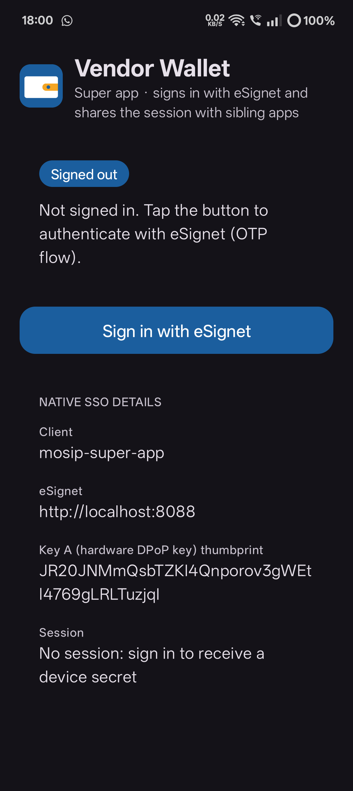 | 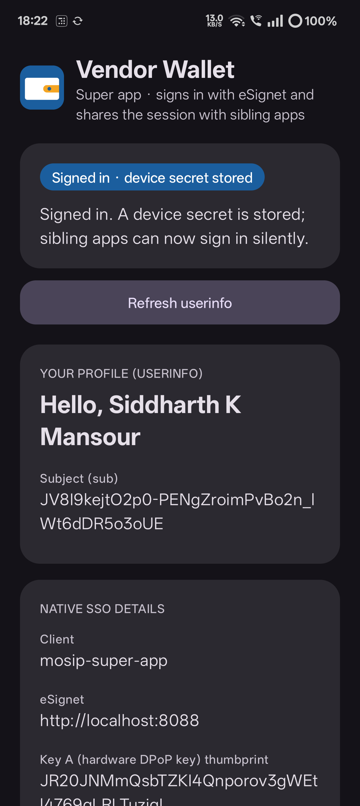 | 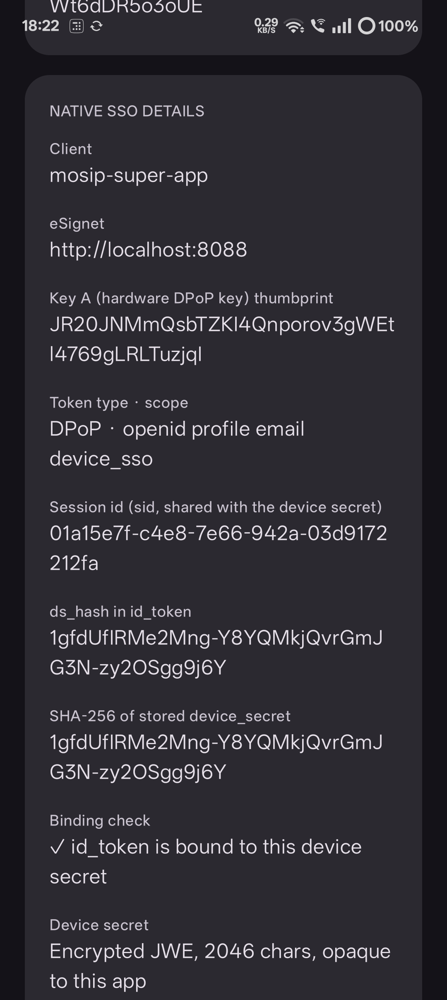 |
| **Signed out.** One primary action. The details card already shows the client id, the eSignet URL and Key A's thumbprint; the session row says a device secret arrives after sign-in. | **Signed in.** The status chip and the consented claims returned by userinfo. | **Native SSO details.** `sid`, `ds_hash`, the SHA-256 of the stored device secret and the binding check, so the user and a reviewer can see the hand-off material. |

## 2. eSignet login (Custom Tab)

| | | |
|---|---|---|
| 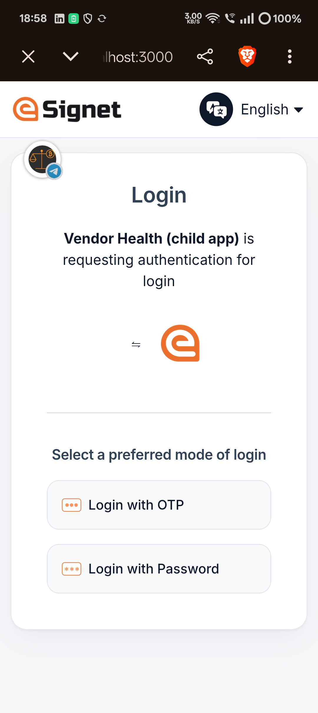 | 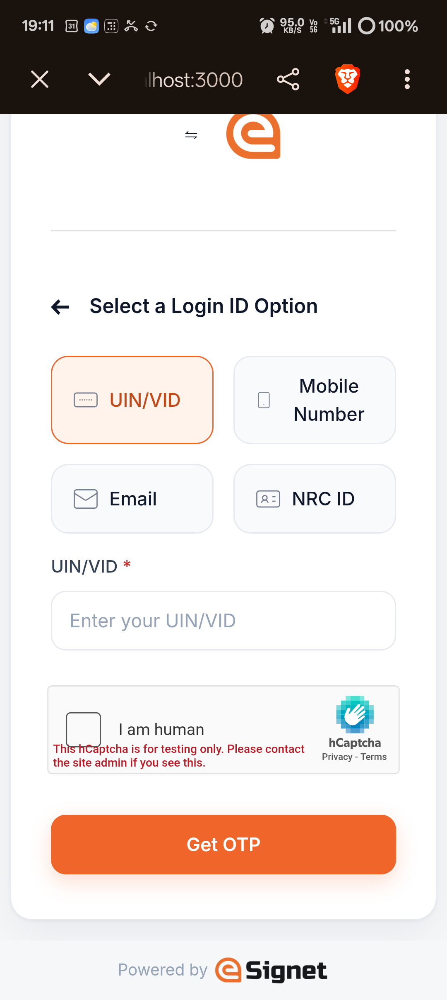 | 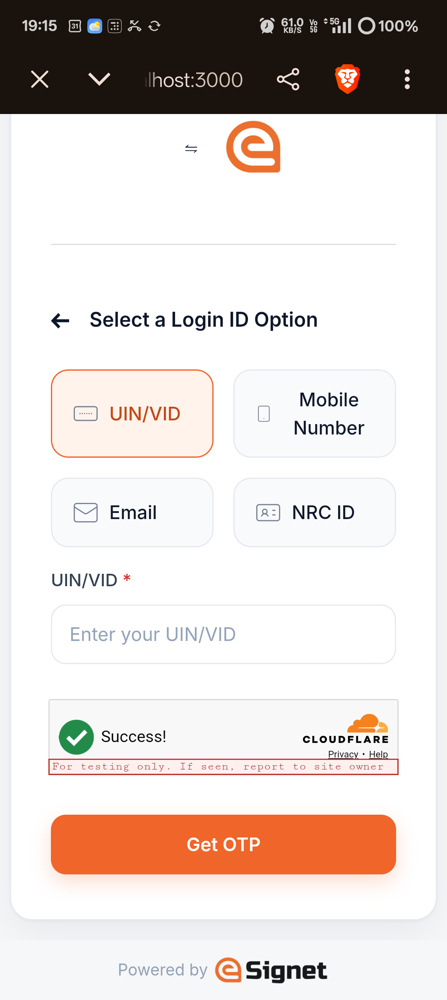 |
| **Mode selection** in the modern theme. This capture is the interactive login opened for Vendor Health during the re-consent branch; the Wallet's first login shows the same page for Vendor Wallet. | **Login ID entry** (UIN/VID, mobile, email) with the single accent colour. | **Captcha and Get OTP.** The Turnstile dummy key auto-passes and fits the card. The red "for testing only" line is drawn by the public test key. |

The restyle is described in [`../ui-theme/README.md`](../ui-theme/README.md). Captures of the login pages
were taken on the phone in a Custom Tab.

## 3. Vendor Health (child app)

| | | |
|---|---|---|
| 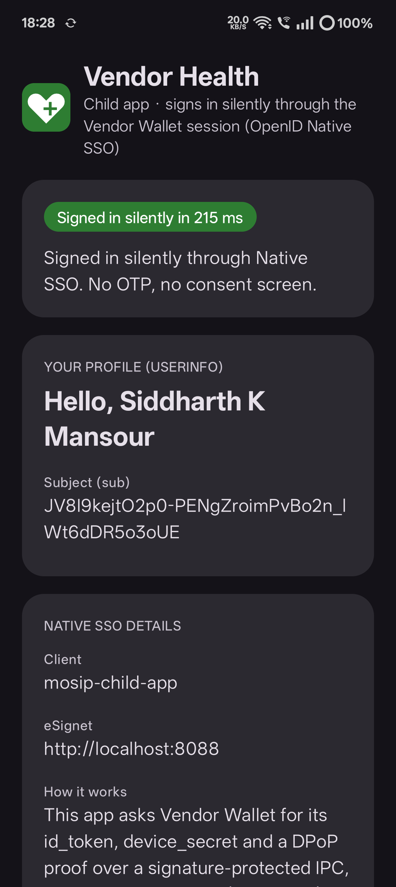 | 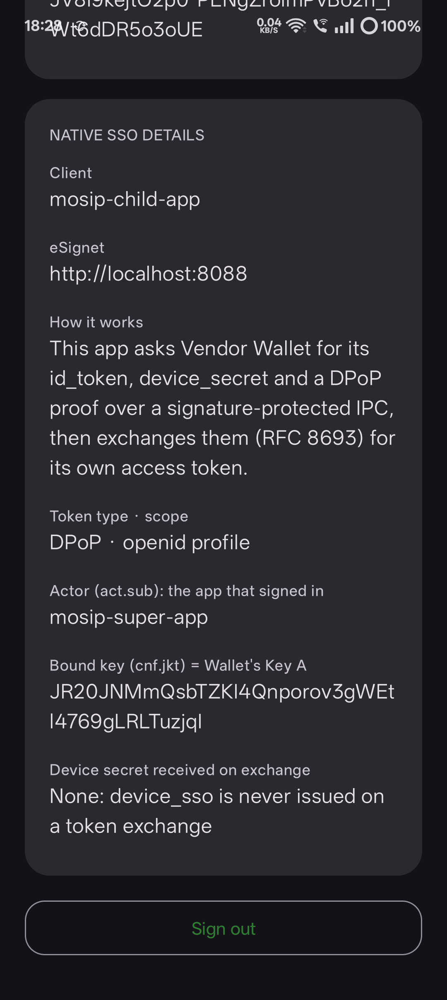 | 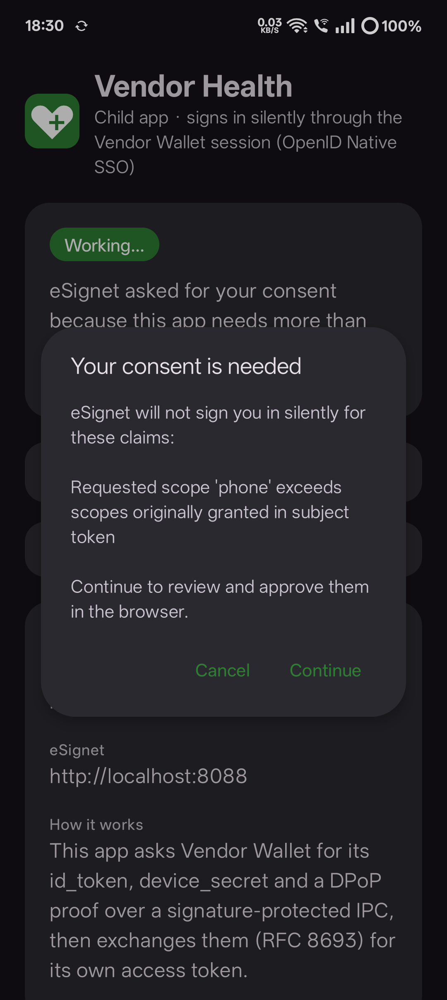 |
| **Silent sign-in.** No browser, OTP or consent; the chip reports the time taken ("Signed in silently in N ms", 185–215 ms across the recorded runs) and the profile shows the consented claims. | **Native SSO details.** Token type and scope (`DPoP`, `openid profile`), `act.sub = mosip-super-app`, `cnf.jkt` equal to the Wallet's Key A, and "no device secret received on exchange". | **Re-consent dialog.** When the child asks for `phone`, which the Wallet was never granted, eSignet refuses the silent path (`invalid_scope`; `interaction_required` when a granted claim was unticked) and the app explains why before opening the browser. |

## 4. User flows

### 4.1 Super app login

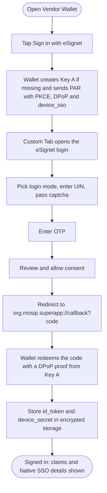

### 4.2 Child silent sign-in, with the re-consent branch

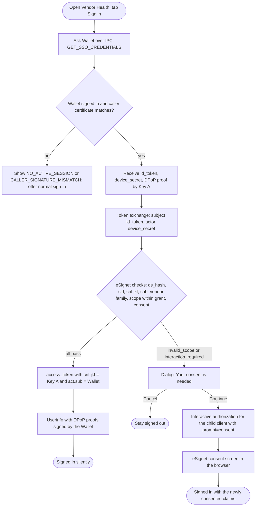

## 5. UX rationale

- **One tap for the second app.** Opening Vendor Health and tapping *Sign in* is the whole interaction; the silent
  path took 185–215 ms on the test phone, with no browser, OTP or consent screen.
- **Visible bindings build trust.** Both apps show the key thumbprint, `sid`, `ds_hash`, `act.sub` and `cnf.jkt` in readable
  rows, so a user or reviewer can verify that the child's token is bound to the Wallet's key.
- **A refusal explains itself.** The re-consent dialog names the scope or claims that need approval and offers
  Cancel or Continue instead of failing silently.
- **Edge-to-edge safe areas.** The apps draw behind system bars and apply `fitsSystemWindows`, so content is not hidden by the status or navigation bar.
- **Readable key/value rows.** Label above value, long tokens and thumbprints wrapped at full width at a large text size.
- **Modern minimal eSignet theme.** Inter type, rounded cards, a single warm accent (#F0652A) and a compact captcha
  that fits a phone-width card; applied through a server theme and a mounted stylesheet, without rebuilding the UI image.
