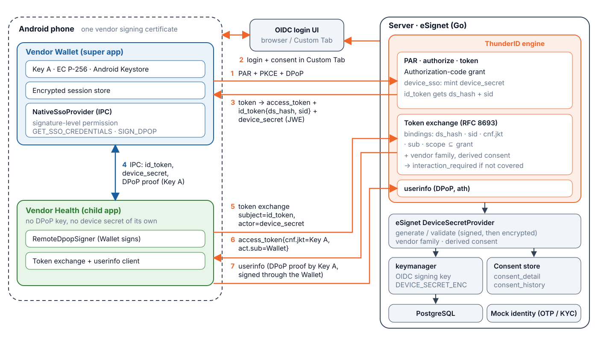

# Solution overview

**MOSIP Decode 2026 · Problem statement 03 · eSignet | Enable Native SSO in eSignet Go for Mobile Apps**

Team: **AlphaQ**

## Problem

Native Android apps do not share cookies. Every app of one vendor repeats the full eSignet login
(UIN, OTP, consent), although the user already proved who they are minutes ago in the vendor's other
app. A shared browser session does not exist on native apps and would not bind the session to the device.

## Solution in three moves

1. **Sign in once, with a device secret.** The first app (the *super app*, Vendor Wallet) logs in with PAR, PKCE and DPoP and
   asks for the `device_sso` scope. eSignet answers with an access token, an ID token carrying `ds_hash`
   and `sid`, and a `device_secret`: a signed-then-encrypted JWT only eSignet can read. Everything is
   bound to a hardware key (Key A) in the Android Keystore.
2. **Hand over through a protected IPC.** A sibling app (the *child app*, Vendor Health) asks the
   Wallet over a signature-permission ContentProvider for the `id_token`, `device_secret` and a DPoP
   proof signed by Key A. The child never holds a key.
3. **Exchange silently.** The child performs an RFC 8693 token exchange (subject = ID token,
   actor = device secret). eSignet verifies the bindings and returns the child's own access token. If the
   user never consented to what the child asks for, eSignet answers `interaction_required` and the child
   falls back to an ordinary consent screen.

## What was built

- **ThunderID engine** (`repos/thunderid`, branch `feature/ps03-native-sso`): `device_sso` scope, the
  `DeviceSecretProvider` and `DeviceSSOConsentProvider` interfaces, device-secret issuance, the token
  exchange grant with all validations.
- **eSignet (Go)** (`repos/esignet-go`, branch `feature/ps03-native-sso`): the provider implementation
  (keymanager-backed), vendor-family isolation, derived consent with an audit trail, client registration,
  configuration and OpenAPI.
- **Android** (`mobile-sample/`): `nativesso-sdk` library, Vendor Wallet and Vendor Health, signed with
  one vendor certificate.
- **Tests**: 35-check end-to-end script (35/35 pass), unit tests in both repositories and a phone walk-through
  on a OnePlus CPH2531 (Android 15). See [test cases and results](test-cases-and-results.md).
- **Postman collection** in `postman/`, a modern minimal login theme in `ui-theme/`.
- **Documents**: [design document](design-document.md), [API documentation](api-documentation.md),
  [mockups and flows](mockups-and-flows.md), demo script, pitch deck.

## How it is secured

| Binding | What it stops |
|---|---|
| `ds_hash` | an ID token used with a different device secret |
| `sid` | secrets and tokens from different sessions |
| `cnf.jkt` | a stolen token pair without Key A (DPoP proof must come from that key) |
| `sub` | mixing identities |
| `scope` ⊆ grant | a child receiving more than the super app was granted; `device_sso` is never exchangeable |
| vendor family and consent | other vendors redeeming the secret; claims the user did not accept |

In addition the IPC is guarded by a `signature` permission with a certificate re-check, and the device
secret is opaque to the apps. Limits (single-use `jti`, revocation on sign-out) are listed in the
[design document](design-document.md#8-security-notes-and-limits).

## Task coverage

All PS03 tasks 1 to 10 and the re-consent bonus are implemented; the table with the code location for
each is in the [README](../README.md#task-coverage).

## How to run

Local stack, clients, end-to-end test and app build: [README](../README.md#verify-it-in-ten-minutes-no-phone-needed)
and [mobile-sample/README.md](../mobile-sample/README.md). Test identity: UIN `1774231323`, OTP `111111`.
